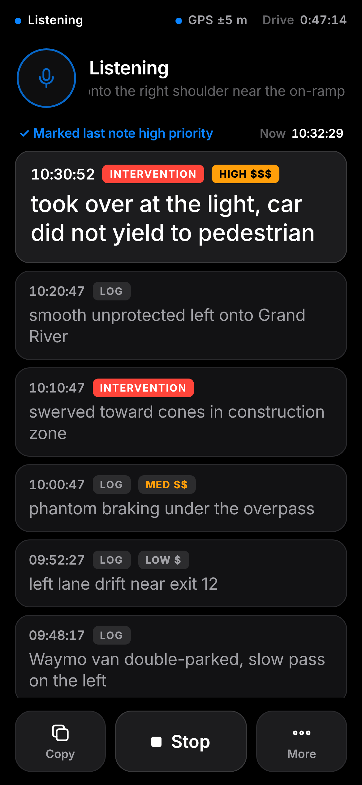
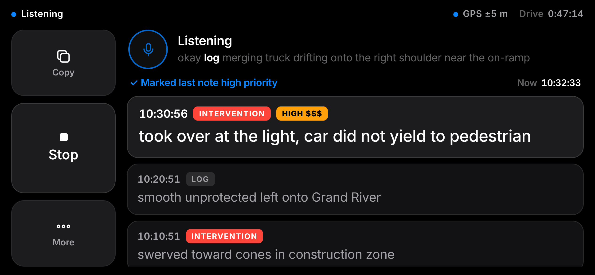

# Drive Logger

A hands-free voice "drive event recorder" for autonomous-vehicle test drives. Mount the phone on the dash, tap the mic,
and say **"log …"** or **"intervention …"**. Each note is saved with a timestamp (and GPS location), and the whole drive
copies straight into a spreadsheet.

**Live app: https://jkippy.github.io/drive-logger/** (canonical URL)

It's a static Progressive Web App: vanilla JS, no build step, nothing leaves the phone. Speech recognition is the browser's
Web Speech API (Safari on iPhone, Chrome on desktop/Android).

| Portrait | Landscape (dash mount) |
| --- | --- |
|  |  |

## Install on iPhone
1. Open **https://jkippy.github.io/drive-logger/** in **Safari**.
2. Share › **Add to Home Screen**.
3. Open it, tap the mic, and allow **Microphone** and **Location**.

## How to use
- Tap the orb (or **Start**). Say **"log"** or **"intervention"**, then describe the event:
  *"log left lane drift near exit 12"* · *"intervention took over at the light"*.
- A note is saved after about 2.5 s of silence (or when the recognizer finalizes the sentence). You get a short spoken
  reply ("Logged.", "Intervention noted.") or a chime, and the new card is briefly highlighted.
- Speech without a keyword or a command is ignored.
- **Copy** puts the current session on the clipboard as tab-separated rows. Paste into Google Sheets or Excel and it lands in columns.
- **More** has the full notes list (edit/delete), sessions (+ New session), Download CSV, Share, settings
  (spoken replies or chime, GPS, night dim, landscape control side), Corrections and Help.

### Voice commands (no keyword; say them as their own sentence)
| | Examples |
| --- | --- |
| Priority | "mark that high priority" · "make it medium" · "that's low priority" · "bump that to high" · "set priority high" · "that's urgent" · "give the one before that high priority" · "remove the priority" |
| Inline priority | "log **high priority** brake fade on the downhill" → `brake fade on the downhill $$$` |
| Delete | "scratch that" · "delete that last one" · "never mind" (within 60 s of a note) |
| Undo | "bring that back" · "undo" |
| Add | "add to that, …" (any time) · "also, …" (within 60 s) |
| Change type | "change that to an intervention" · "make that a log" · "that was an intervention" |
| Mark | "mark" saves a timestamped `[marked event]`; fill it in later with "add to that, …" |
| Ask | "read that back" · "what was the last note" · "how many notes" · "how many interventions" |
| Pause | "pause notes" / "stop taking notes" → only "resume notes" / "start taking notes" is heard |

Commands are never taken from text you're dictating after a keyword. The app stops listening while it speaks a reply so it
can't transcribe itself.

### Accuracy helpers
- Requests 5 recognition alternatives and prefers one that starts with a keyword or is a command.
- Common mishearings are accepted **at the start of an utterance only**: "blog", "lock", "logged", "logs", "lug", "long", "la" → *log*;
  "intervene", "in convention", "inter mention" → *intervention*. "log log …" collapses to one note.
- **Corrections** (More sheet): editable *heard → written* pairs applied to note text, seeded with AV terms
  (way mo → Waymo, lie dar → lidar, phantom breaking → phantom braking, zooks → Zoox, …).

## Data safety (crash-proofing)
Notes live only on the phone, so the app is built so a Safari crash, a killed tab or a wiped store doesn't lose them:

- **Two stores, written on every change.** Each create/edit/delete/priority change is written right away to
  **localStorage** (synchronously) **and IndexedDB** (a strict-durability transaction). On launch both are read and merged by
  note id; the newest `updatedAt` wins. Deletes are kept as tombstones so a stale store can't bring a deleted note back.
  If one store is wiped, corrupted or evicted, the other refills it.
- **Drafts.** The moment a keyword is heard, the in-progress note (with its keyword-time timestamp and GPS fix) is saved
  as a draft in both stores and updated as you keep talking. If the page dies before the note is final, the next launch
  restores it as a note ending in **“(recovered)”**.
- **Journal.** Every change event (create, edit, delete, priority, retype, restore, recover) is appended to a local journal
  (all events in IndexedDB, the newest 500 also in localStorage). **More › Recently deleted** lists deleted notes with a
  Restore button, and “bring that back” still undoes the last delete.
- **Backup / restore.** **More › Export full backup (JSON)** saves every note (including deleted ones), sessions, settings and
  the journal. **Restore from backup…** *merges*: missing notes are added and newer edits win. Nothing is overwritten or deleted,
  and restoring the same file twice changes nothing.
- **End-of-drive nudge.** Tapping **Stop**, or **New session**, while the session has notes that were never exported shows
  *“N notes not exported yet · Copy / Download / Share”*. The More sheet shows “N notes not exported” or the last export time.
- **Warnings.** A banner appears if a store fails (quota, blocked) or if the app detects **Private Browsing**, which erases
  everything when the tab closes. **More › Storage & backup** shows both stores' status, whether storage is *persistent*
  (`navigator.storage.persist()`), and whether you're in a browser tab or the Home Screen app.

Safari limits to know about:
- In a regular Safari tab, Safari deletes all of a site's script-written storage (localStorage **and** IndexedDB) after
  7 days of browser use without visiting the site. **Home Screen web apps are exempt.**
- The Home Screen app and Safari tabs keep **separate** storage. Notes taken in one don't appear in the other, so pick one
  (the Home Screen app is recommended) and use a JSON backup to move between them.
- Two stores on the same phone don't protect against losing the phone or iOS clearing website data. Export after each drive.

### Backing up to Google Sheets
Every note change (create, edit, priority, retype, delete, restore, recover) is copied automatically to a Google Sheet you own,
through a small Apps Script web app bound to that sheet ([`docs/sheets-sync.gs`](docs/sheets-sync.gs)).

**Set up (once):**
1. In the backup spreadsheet, open **Extensions › Apps Script**. Replace the code with `docs/sheets-sync.gs`, and set `TOKEN`
   to a long random string.
2. **Deploy › New deployment › Web app**, with *Execute as: Me* and *Who has access: Anyone*. Deploy, authorize, and copy the
   URL ending in `/exec`.
3. On the phone, open the **pairing link** `https://jkippy.github.io/drive-logger/#sync=<URL-encoded /exec URL>&token=<TOKEN>`
   and tap **Turn on backup**. You can also enter the URL and token under **More › Sheets backup** and switch it on (pasting a
   pairing link into the URL field fills in both). Existing notes are sent right away.
   The Home Screen app has its own storage, so if you use it, paste the pairing link into its URL field there.

**How it behaves**
- Changes go into an outbox on the phone and are sent in batches. Each row is updated in place by **Note ID**, so retries never
  create duplicates, and an older version never overwrites a newer one. Deleted notes stay in the sheet with `Deleted = TRUE`.
- Failed or offline sends stay queued and retry with backoff, when the connection returns, and when the app comes back to the
  foreground. The queue survives reloads.
- The status row shows a small cloud: grey when synced, amber with a count while notes are waiting, and red with "!" on errors.
  More › Sheets backup shows *Last synced HH:MM:SS · N pending* and the last error. **Send test** checks the URL, access and
  token; **Sync now** retries immediately.
- **Columns** (in one `COLUMNS` table in the script): Time (cmd+shift+:), Logtime (s), Type, Triage Priority, Comments
  (the export columns), then Lat, Lon, Session, Note ID, Updated, Deleted, Received. Columns are matched by header name,
  so you can reorder them or add your own; missing headers are appended.

**Why text/plain:** Apps Script can't answer a CORS preflight (there is no `doOptions`), so the app POSTs a `text/plain` JSON
body. That's a "simple request": the `/exec` 302 (which carries `Access-Control-Allow-Origin: *`) is followed to
`script.googleusercontent.com`, and the JSON reply can be read, so each batch is confirmed. Google's error pages have no CORS
header, so a wrong URL, access not set to "Anyone", or a server error all show as "Couldn't reach the script".

**Security:** the web app runs as the sheet owner with access "Anyone", so the URL alone can reach it. Every POST must carry the
token, which goes in the request body, never the URL. The pairing link puts the token in the `#hash`, which browsers never send
to a server, and the app removes it from the address bar immediately. A pairing link only pairs to `script.google.com/…/exec`
URLs, and only after you confirm. JSON backups don't include the token. `@OnlyCurrentDoc` limits the script to the one sheet it's
bound to. Rotate the token by changing `TOKEN`, redeploying (*Manage deployments › Edit › New version*) and re-pairing. Note text
is stored in your Google account, so check that's allowed for test-drive data.

## Export format
Tab-separated (Copy) or CSV (Download / Share). Exact columns for Jason's spreadsheet:

| Time (cmd+shift+:) | Logtime (s) | Type | Triage Priority | Comments |
| --- | --- | --- | --- | --- |
| 2:03:22 PM |  | Log |  | left lane drift near exit 12 |
| 10:43:25 AM |  | I |  | took over at the light $$$ |

- **Time** is the phone's local clock in 12-hour AM/PM form, no leading zero on the hour (`1:01:45 PM`, `12:01:05 PM`).
- **Logtime (s)** and **Triage Priority** are left empty — filled in later during triage.
- **Type** is `Log` or `I` (intervention).
- **Comments** is the note text; priority markers stay here: `$$$` high, `$$` medium, `$` low.
- Header row is optional for Copy (checkbox in More) and always included in Download CSV / Share.
- GPS coordinates stay on each note (and in the Sheets backup) but are **not** in Copy/CSV.

### Timestamps
A note's time is the phone clock at the moment the recognizer first reported the keyword (or the start of the
utterance, if it opens with the keyword). Recognition typically reports words about 0.5–1.5 s after they're spoken, so
times may run that much late. The status row shows **Drive** (session elapsed time) and **GPS ±N m** (location
accuracy), and **Now** above the notes is the device clock, for comparison with note times.

## iOS notes
- Keep the app **in the foreground with the screen on**. iOS stops recognition when the screen locks or you switch apps;
  it resumes when you come back. The app holds a Screen Wake Lock (iOS 16.4+).
- Safari may ask for microphone and location permission again after a reload or relaunch, especially from the Home Screen.
- Needs **Siri & Dictation** enabled (Settings › General › Keyboard › Enable Dictation) and usually a network connection.
- Turn off Silent mode to hear spoken replies. Web apps can't vibrate on iPhone.
- If listening misbehaves in the Home Screen app, use it in a regular Safari tab.
- Notes are stored only on the phone (localStorage + IndexedDB) and are tied to the site address, so export after each drive. See *Data safety*.

## Development
```
index.html  style.css  app.js   UI, speech recognition, commands, GPS, export, nudge, backup UI
core.js                         pure logic: keyword parsing, command grammar, priority, corrections, TSV/CSV
persist.js                      pure logic: two-store merge, drafts/recovery, journal, backup/restore, export tracking
store.js                        localStorage + IndexedDB adapter, persist(), Private Browsing check, Sheets backup client
docs/sheets-sync.gs             Apps Script endpoint (token placeholder); `node tools/make-ready-script.js` builds the
                                git-ignored docs/sheets-sync-ready.gs with the real token
tools/gas-mock.js, fake-gas.js  mock Apps Script runtime + fake endpoint (mimics Google's 302 → googleusercontent flow)
sw.js  manifest.json  icons/    PWA (network-first service worker)
test.js                         unit tests: node test.js
tools/*.js                      headless Chromium flows (fake speech recognizer)
```
- Unit tests: `node test.js`
- Serve locally: `python3 -m http.server 8787` → http://127.0.0.1:8787/
- Headless flows need `playwright-core` and Chrome:
  `npm i playwright-core` then `NODE_PATH=./node_modules node tools/cmdtest.js` (also `gpstest.js`, `accuracytest.js`,
  `timestamptest.js`, `durabilitytest.js`, `synctest.js`, `shot.js`). `synctest.js` runs the real script behind the fake endpoint
  (local http only). `durabilitytest.js` crashes the page and SIGKILLs the browser mid-note,
  wipes each store in turn, and round-trips a backup. Set `BASE_URL` to test another copy, e.g.
  `BASE_URL=https://jkippy.github.io/drive-logger/ node tools/smoketest.js`.
- Bump `CACHE` in `sw.js` on each release so installed copies refresh.

Dev note: during prototyping the app was also served from a temporary tunnel (hostc) on the build box. GitHub Pages is
the canonical URL.
